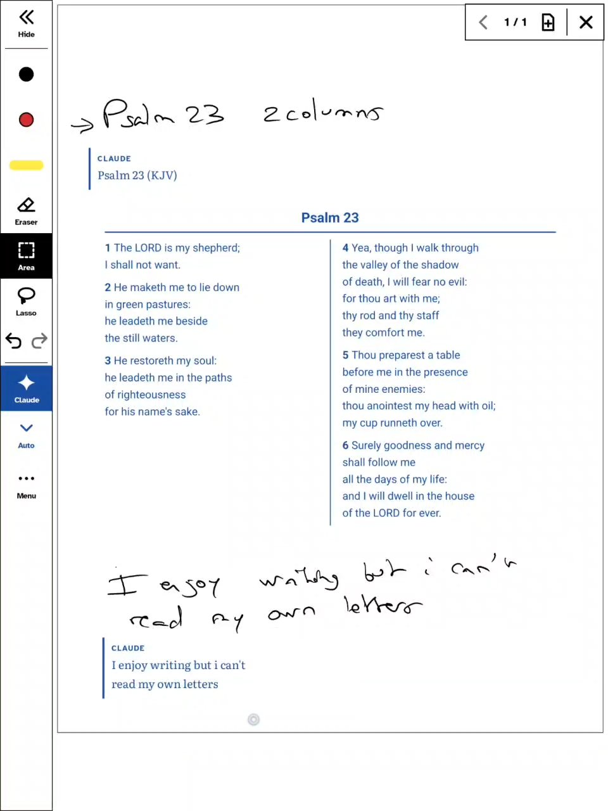

# Plume · Handwriting + Claude

A handwriting notebook for Boox e-ink tablets, with Claude built in. Interface in English and French. On the tablet, the app is simply called **Plume**.

Write with the stylus as on paper, then ask Claude to transcribe, summarize, structure or continue your notes, or to draw a table, diagram or calendar you fill in by hand.

<a href="https://gaby974-cloud.github.io/plume/#demo"></a>

*[Watch the 1-minute demo](https://gaby974-cloud.github.io/plume/#demo) on a Boox Note Air C.*

**[Download the latest APK](https://github.com/gaby974-cloud/plume/releases/latest/download/Plume.apk)** · [Website](https://gaby974-cloud.github.io/plume/) · [Privacy policy](https://gaby974-cloud.github.io/plume/privacy.html)

## Install

1. Download `Plume.apk` on your tablet (or copy it with USB or BooxDrop).
2. Open it and allow installing apps from this source.
3. In Plume → Settings, paste your Anthropic API key (from [console.anthropic.com](https://console.anthropic.com)).

## Good to know

- Android 11+. Built for Boox, tested on a Boox Note Air C; other Android tablets work without the low-latency pen.
- You use your own Anthropic API key; Claude usage is billed by Anthropic per use.
- Notes stay on your tablet. No server, no account, no analytics.
- Google Drive backup (PDF copies) is optional.

**Shared as-is.** I fix major bugs when I can, but I don't take feature requests or offer support. Found a serious bug? [Open an issue](https://github.com/gaby974-cloud/plume/issues). Want more? Feel free to fork it.

## Build from source

Requirements: JDK 17 and the Android SDK (platform 35).

1. Create `local.properties` at the root with `sdk.dir=<path to your Android SDK>`.
2. Build and run the tests:

   ```bash
   ./gradlew assembleDebug testDebugUnitTest
   ```

   The APK is in `app/build/outputs/apk/debug/`.

Optional entries in `local.properties` (never committed):

- `drive.clientId` and `drive.clientSecret`: an OAuth client of type "Desktop app" from your own Google Cloud project with the Drive API enabled. Without them, Google Drive backup is simply unavailable in Settings.
- `release.storeFile`, `release.storePassword`, `release.keyAlias`, `release.keyPassword`: your signing key for `./gradlew assembleRelease`.

Claude modes and prompts live in `app/src/main/assets/modes.json` (French) and `modes-en.json` (English); add a `{ "id", "label", "task" }` entry to both to create a mode. UI strings are written in place as `tr("français", "english")` (see `Lang.kt`).

A detailed developer guide in French (architecture, Google setup, Boox notes) is in [README.fr.md](README.fr.md).

## Built with

Kotlin, Jetpack Compose, Room, OkHttp, [AndroidSVG](https://github.com/BigBadaboom/androidsvg) and the Onyx (Boox) pen SDK, downloaded from Onyx's Maven repository at build time. Claude is called through the [Anthropic Messages API](https://docs.anthropic.com/).

## License

Plume's code is released under the [MIT License](LICENSE). The bundled fonts, Atkinson Hyperlegible and Literata, are under the SIL Open Font License 1.1 ([licenses/](licenses/)).

Plume is an independent project, not affiliated with Onyx (Boox), Anthropic or Google.

---

*Français :* carnet de notes manuscrites pour liseuse Boox, avec Claude intégré. [Page en français](https://gaby974-cloud.github.io/plume/fr.html) · [Guide du développeur](README.fr.md).
